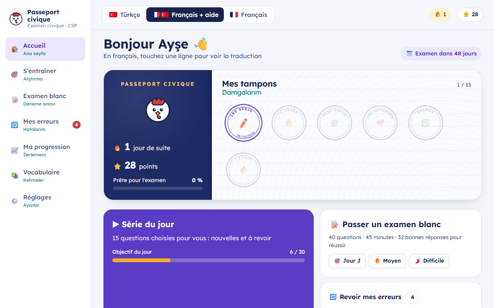
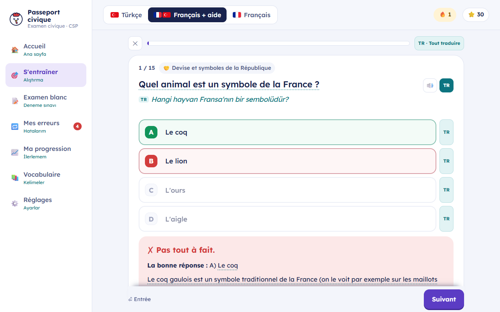

# Passeport civique

**Prepare the French civic exam at your own pace, with help in your own language.**
Free, no account, works offline. Unofficial app.

The civic exam (*examen civique*) is required for the French multi-year residence permit, the resident card and naturalisation: a 40-question multiple-choice test in French, 45 minutes, 32 right answers to pass. Passeport civique helps people who are learning French prepare for it, moving step by step from their own language to French.

| Home | Question with translation |
|---|---|
|  |  |

## Features

- **250 questions**: the 190 knowledge questions from the official list and 60 real-life scenarios, each with 4 choices, an explanation and useful vocabulary.
- **Three ways to study**: everything in your language, French with translation on demand, or everything in French as on exam day.
- **Reading aloud** with natural open-source voices ([Piper](https://github.com/rhasspy/piper)) computed on your device: downloaded once per language (≈ 63 MB), then offline. Mixed French / help-language text is read with the right voice for each part.
- **Daily series** with spaced repetition: missed questions come back quickly.
- **Changing choices**: once a question is answered right, new wordings and new traps appear, so you learn the content rather than the position of the answer.
- **Mock exams**: 40 questions, 45 minutes, same split as the official exam. Three levels: "Exam day", "Medium" and "Hard".
- **Mistakes, progress, vocabulary**, and resuming a series you started.
- **Profiles**: several people on the same device, each with their own progress.
- **Coco, the AI tutor (optional)**: explains questions and answers in your language, and keeps your conversations. It runs on your own computer with [Ollama](https://ollama.com): nothing is sent online. The app works fully without AI.

Help language available today: **Turkish**. The app is built so that other languages can be added (see [CONTRIBUTING.md](CONTRIBUTING.md)): Arabic, Dari, Persian, English, Russian…

## Use the app

### Web version (recommended)

Open **https://minihollow.github.io/passeport-civique/** in Chrome, Edge, Firefox or Safari. To install it as an app (icon on the desktop or home screen, offline use): browser menu → "Install app" or "Add to Home Screen".

Progress is saved in the browser of that device. Export it from time to time (Settings → Backup).

**With Coco**: install [Ollama](https://ollama.com/download), then follow the steps shown in Settings → AI tutor: the site must be allowed to use Ollama (one command to copy and paste), then Ollama restarted.

### Windows package

Download **`Passeport-civique-Windows.zip`** from the [Releases](https://github.com/minihollow/passeport-civique/releases) (not "Source code"). Right-click → Properties → Unblock, then Extract All, and run `Installer.bat`. The installer offers to install Coco and picks the AI model that suits your graphics card. Details in the *Install guide* included in the zip.

## Content

The wording of the 190 knowledge questions comes from the official questions published by the French Ministry of the Interior under the Licence Ouverte 2.0 ([dataset "Examen civique - CSP"](https://www.data.gouv.fr/datasets/examen-civique-csp) on data.gouv.fr). The answer choices, explanations, vocabulary, scenarios and translations were written for this project, checking the answers against official sources.

**Unofficial app.** Rules can change: for any procedure, the reference is [service-public.fr](https://www.service-public.fr) and your prefecture. Found a mistake in a question? Please open an issue.

## License

- Code: [MIT](LICENSE).
- Content (choices, explanations, vocabulary, scenarios, translations): [CC BY-SA 4.0](content/LICENSE.md).

## Credits

- Voices: [Piper](https://github.com/rhasspy/piper) (MIT), through [piper-tts-web](https://github.com/Mintplex-Labs/piper-tts-web) (MIT) and [ONNX Runtime Web](https://onnxruntime.ai) (MIT). Pronunciation: espeak-ng (GPL-3.0), loaded from a CDN on first use. French voice "Siwis" (CC BY 4.0, University of Edinburgh), Turkish voice "DFKI" (CC BY-NC-SA 4.0).
- AI tutor: [Ollama](https://ollama.com) and Google's Gemma models, installed by those who want them.
- Font: Lexend (SIL Open Font License).

## Development

Requires Node.js 18 or later.

```sh
cd web
npm install
npm run build   # generates web/src/data/questions.json from content/, then the interface
npm run dev     # http://localhost:5173 (progress in the browser, Coco through a local Ollama)
```

- `content/`: questions (one file per theme, plus `situ.json` for the scenarios).
- `web/`: React interface (Vite). `web/src/lang/`: help languages.
- `launcher/launcher.ps1`: Windows launcher (small local server, saves to `%APPDATA%\CivicTR`, proxies Ollama).
- `package/`: Windows installer and guide. `node scripts/build.mjs` builds `out/Passeport-civique-Windows.zip`.
- `.github/workflows/`: web version published to GitHub Pages on every update of `main`; Windows zip attached to each GitHub Release.

To contribute (corrections, translations, code): [CONTRIBUTING.md](CONTRIBUTING.md).

---

### En français

Passeport civique est une application gratuite pour préparer l'examen civique français (carte de séjour pluriannuelle, carte de résident, naturalisation), avec l'aide de sa langue (le turc pour l'instant). Version web : **https://minihollow.github.io/passeport-civique/**. Version Windows : `Passeport-civique-Windows.zip` dans les [Releases](https://github.com/minihollow/passeport-civique/releases). Application non officielle : vérifiez toujours sur [service-public.fr](https://www.service-public.fr).
